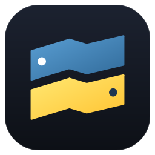

<p align="center">
  
</p>

<h1 align="center">Pytrolio</h1>

<p align="center">
  A modern desktop app for your Trade Republic account, built with PySide6 on top of
  <a href="https://github.com/pytr-org/pytr">pytr</a>.
</p>

---

## Features

- **Sign in once** – confirm the login in the Trade Republic app (or with an SMS / authenticator code). The session is reused for all tasks.
- **Portfolio overview** – depot value with gain/loss, cash and total at a glance, plus a sortable, filterable table of your positions.
- **Tasks** – live prices, instrument details, price alarms (view & edit), savings plans, transaction export (e.g. for Portfolio Performance) and document download.
- **Results as tables** – sort, filter, copy or export them to CSV.
- **Dark & light theme** – follows your system by default.
- **Easy to customise** – the layout is a Qt Designer file (`assets/ui/main_window.ui`), all styling lives in `assets/theme/theme.qss`.

## Getting started

Requires **Python 3.14+** and [uv](https://docs.astral.sh/uv/).

```bash
git clone <your-repo-url>
cd TradeRepublicAPI
uv sync          # installs PySide6 and pytr
uv run app.py
```

Without uv: `pip install pyside6-essentials pytr` and `python app.py`.

1. Open **Account**, enter your phone number and PIN and press **Sign in**.
2. Confirm the login in the Trade Republic app.
3. Pick a task in the sidebar (e.g. **Portfolio**) and press **Run**.

## Privacy

- Your phone number, PIN and session are stored **only on your computer** by pytr, in `~/.pytr` (only if “Stay signed in” is enabled). Nothing is sent anywhere except to Trade Republic.
- Exports and downloads go to the working folder chosen in **Settings** (default: `Documents/TradeRepublic`).
- The `.gitignore` keeps credentials, cookies, CSV exports, PDFs and logs out of the repository.

## Project layout

```text
app.py                     application logic
assets/ui/main_window.ui   window layout (Qt Designer)
assets/theme/theme.qss     colours, fonts and styles (dark + light)
assets/icon/               app icon and UI icons
```

## Credits & disclaimer

Pytrolio is a graphical front-end for [pytr](https://github.com/pytr-org/pytr), which does all
communication with Trade Republic.

This is an unofficial hobby project. It is **not affiliated with, endorsed by or supported by
Trade Republic Bank GmbH**. Use at your own risk – no financial advice.
